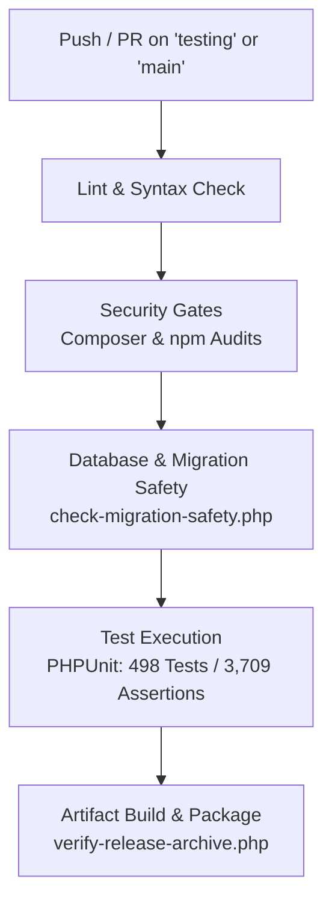

# CI/CD Pipeline Architecture, Verification & Deployment Audit

**Project:** SMS Laravel — School Management System  
**Branch:** `testing`  
**Verified Commit:** `30a2a09`  
**Pipeline Engine:** GitHub Actions  
**Status:** Hardened & Validated  

---

## 1. Overview of Workflows

The repository's automation is orchestrated by two continuous integration and deployment workflows:
1. **`.github/workflows/ci.yml`**: Validates pull requests and branch pushes with linting, security audits, migration safety, and the full test suite.
2. **`.github/workflows/cd.yml`**: Automates zero-downtime staging and production deployments via SSH, atomic symlink switching, database migration guards, and post-deployment health verification.

---

## 2. CI Pipeline Stages (`ci.yml`)

The continuous integration pipeline comprises five sequential and parallel stages designed to prevent regressions and security vulnerabilities:



### 2.1 Linting & Static Code Analysis
- Executes `composer validate --strict` to verify `composer.json` and `composer.lock` consistency.
- Runs PHP syntax validation across all application controllers, models, and migrations.

### 2.2 Security Gates
- Runs `php .github/scripts/audit-checker.php` against Composer dependencies.
- Runs `node .github/scripts/npm-audit-checker.js` using Node 22 to audit npm dependencies against the approved exception registry.

### 2.3 Migration Safety Verification
- Executes `php .github/scripts/check-migration-safety.php --strict` across all 57 migrations.
- Flags and fails on any destructive SQL statements (`DROP TABLE`, `DROP DATABASE`, `TRUNCATE`).
- Sets up a dedicated MySQL 8 container and runs `php .github/scripts/verify-ci-database.php` to prevent test contamination.

### 2.4 Test Suite Execution
- Runs `vendor/bin/phpunit --configuration phpunit.xml`.
- Enforces passing status on all 498 tests and 3,709 assertions with zero failures or errors.

### 2.5 Release Artifact Packaging & Verification
- Builds minified frontend assets via `npm run production` in Node 14.
- Packages the release archive.
- Evaluates the archive against `.github/scripts/verify-release-archive.php` to ensure zero malicious path traversal patterns or sensitive leaked files.

---

## 3. CD Deployment Safeguards (`cd.yml`)

### 3.1 Zero-Downtime Atomic Symlink Architecture
Deployments adhere to the standard atomic directory structure:
```text
/var/www/sms_laravel/
├── current -> /var/www/sms_laravel/releases/20261114_210000
├── releases/
│   ├── 20261114_200000/
│   └── 20261114_210000/
└── shared/
    ├── .env
    └── storage/
```
- New releases are unpacked into an isolated timestamped directory in `releases/`.
- Shared persistent directories (`storage/app`, `storage/framework`, `storage/logs`) and `.env` are symlinked into the new release.
- Atomic cutover occurs by switching the `current` symlink:
  ```bash
  ln -sfn /var/www/sms_laravel/releases/$RELEASE_TIMESTAMP /var/www/sms_laravel/current
  ```

### 3.2 Database Migration & Rollback Strategy
- Before switching symlinks, the pipeline runs migrations with a pre-flight dry-run check.
- If migrations fail, the deployment immediately halts without modifying the active `current` symlink.
- If health checks fail post-switch, an automatic rollback symlink reversal is executed:
  ```bash
  ln -sfn /var/www/sms_laravel/releases/$PREVIOUS_RELEASE /var/www/sms_laravel/current
  ```

### 3.3 Post-Deployment Health Check Probes
- Performs an HTTP curl probe against the application health endpoint (`/` or `/login`).
- Requires HTTP 200/302 response within 10 seconds.
- Triggers automatic rollback if the endpoint returns HTTP 500 or times out.

---

## 4. Key Fixes Applied to Workflows

1. **Setup-PHP Cache Fix (`Commit 0c6e0b7`):**
   - **Issue:** `shivammathur/setup-php` failed with `Invalid action input 'cache'`.
   - **Fix:** Removed unsupported `cache: composer` input; utilized standard `actions/cache@v4` pointing to `~/.composer/cache` and `node_modules`.
2. **Archive Extraction Ownership Hardening (`Commit ecc3a55`):**
   - **Issue:** Tar extraction on remote hosts could fail if archive contained non-matching UID/GIDs.
   - **Fix:** Added `--no-same-owner` flag to tar command during release unpacking.
3. **Automated CD Test Coverage:**
   - Added `tests/Unit/CdDeploymentSafetyTest.php` (6 tests, 71 assertions) verifying rollback triggers and fail-safe transitions.
