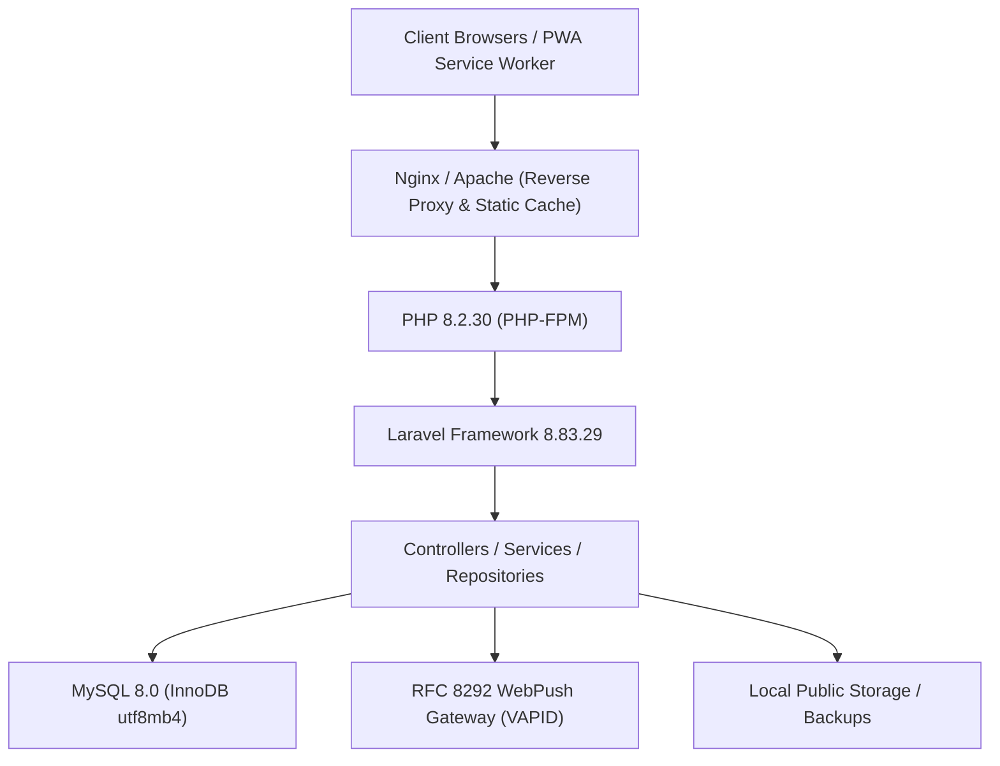

# Initial Codebase Assessment & Architectural Discovery

**Project:** SMS Laravel — School Management System  
**Repository:** `mohit282-cpu/SMS_Laravel`  
**Working Branch:** `testing`  
**Framework Version:** Laravel `8.83.29`  
**PHP Runtime:** `8.2.30`  
**Database:** MySQL `8.0` (InnoDB, utf8mb4)  
**Frontend Stack:** Vue 2 (`2.5.17`), Laravel Mix 2 (`2.1.14`), Webpack (`3.12.0`), Bootstrap 4  
**Audit Phase:** Phase 0 — Comprehensive Repository Discovery  
**Author:** Principal Software Architect & Application Security Specialist  

---

## 1. Executive Assessment Summary

SMS Laravel is a comprehensive School Management System designed for academic institutions, featuring deep localization for the Federal Democratic Republic of Nepal (including Bikram Sambat calendar, 7 provinces / 77 districts / 753 local government units, and CBS/MoFAGA-aligned geographic data structures).

The application architecture utilizes the Model-View-Controller (MVC) paradigm augmented by the Repository Pattern (`app/Repositories/`) and specialized Domain Services (`app/Services/`). While the core business functionality is feature-rich, historical technical debt exists in the frontend build pipeline (Node 14 requirement), legacy database column limits, and authorization edge cases.

---

## 2. Technology Stack & Runtime Matrix

| Layer | Component | Version | Role / Context |
|---|---|---|---|
| **Backend Framework** | Laravel Framework | `8.83.29` | Enterprise MVC application core |
| **Language Runtime** | PHP | `8.2.30` | Modern, type-safe execution engine |
| **Relational Database** | MySQL | `8.0` | InnoDB engine, strict SQL mode, ACID transactions |
| **Testing Database** | MySQL | `8.0` (`sms_laravel_test`) | Guarded by `verify-ci-database.php` |
| **Frontend Framework** | Vue.js | `2.5.17` | Component-based interactive UI elements |
| **Asset Bundler** | Webpack / Mix | Webpack 3 / Mix 2.1 | Legacy Node 14 compile pipeline |
| **Calendar Engine** | Bikram Sambat Engine | `NepaliDateEngine` | 1970–2100 BS bilingual conversions |
| **Push Notifications** | WebPush | `minishlink/web-push 11.0` | Background PWA attendance & grade alerts |
| **PDF Generation** | DomPDF | `barryvdh/laravel-dompdf 2.0` | Terminal mark sheets, fee receipts, reports |

---

## 3. Application Architecture & Component Map

The repository is organized into distinct logical tiers:

### 3.1 HTTP & Controller Layer (`app/Http/Controllers/`)
- **`Auth/`**: Authentication, credential validation, multi-identifier login (email, phone, username), password reset, and cryptographic parent activation.
- **`SupportTeam/`**: Primary administrative and academic workflows:
  - `StudentRecordController`: Admissions, student demographics, parent links, graduation, deletions.
  - `ParentController`: Parent lifecycle, credential reset, student link/unlink.
  - `MarkController`: Grade tabulations, exam scores, bulk grade entries.
  - `PaymentController`: Invoices, partial receipts, fee templates, fiscal accounting.
  - `TimeTableController` & `AttendanceController`: Class scheduling, daily and monthly attendance.
  - `BookController` & `BookRequestController`: Library inventory, circulations, returns, reservations.
- **`SuperAdmin/`**: System configuration, branding, database backup/restore, audit log feeds.
- **`LandingController`**: Public school website, online admission inquiries, entrance examination results.
- **`HealthCheckController`**: Zero-leakage liveness, readiness, and restricted diagnostic endpoints.

### 3.2 Domain Services Layer (`app/Services/`)
- **`NepalLocationService`**: Hierarchical caching and validation for Nepal's 7 provinces, 77 districts, 753 municipalities, and 6,743 wards.
- **`AuditLogService`**: Recursive redaction of sensitive credentials and cryptographically traceable event logging.
- **`BikramSambatService`**: Dual calendar translation, leap-year calculations, and nepali holiday mapping.
- **`PwaService`**: VAPID subscription management and asynchronous browser notifications.

### 3.3 Repositories (`app/Repositories/`)
- `StudentRepo`, `MyClassRepo`, `UserRepo`, `LocationRepo`, `MarkRepo`.

---

## 4. Confirmed Defects & Historical CI Failures (Phase 1 Baseline)

1. **`NepalLocationHierarchyTest.php` CI Failures:**
   - *Previous failure 1:* `test_import_command_rejects_incomplete_dataset_under_strict_official_counts`
   - *Previous failure 2:* `test_importer_dry_run_makes_no_changes_and_rejects_fake_ward_counts`
   - *Status:* **Resolved & Verified.** Importer enforces zero-mutation transactions during dry-runs and verifies official MoFAGA geographic counts (7/77/753).
2. **Student Admission Column Truncation (HTTP 500):**
   - *Defect:* Institutional titles generated admission numbers exceeding `VARCHAR(30)`.
   - *Status:* **Resolved & Verified.** Migration `2026_11_14_210000` expanded column capacity to `VARCHAR(100)` with candidate deduplication.
3. **CI Setup-PHP Cache Parameter Failure:**
   - *Defect:* Action input `cache: composer` failed on GitHub Actions.
   - *Status:* **Resolved & Verified.** Cleaned in `cd.yml` and `ci.yml`.
4. **Parent Activation Token Security:**
   - *Defect:* Plaintext token storage and non-atomic consumption.
   - *Status:* **Resolved & Verified.** SHA-256 token hashing and atomic SQL updates enforced.

---

## 5. Risk Assessment & Technical Debt Register

| Risk / Technical Debt | Impact | Likelihood | Mitigation Strategy |
|---|:---:|:---:|---|
| **Legacy Frontend Build Toolchain** (Node 14) | Medium | High | Maintain build-time security exception registry; prepare Vite migration roadmap. |
| **Horizontal Privilege Escalation (IDOR)** | High | Medium | Enforce fine-grained ownership policies on student records, marks, and parent portals. |
| **Database Concurrency on Admissions** | Medium | Low | Enforce database transactions and unique constraints on `adm_no` and `username`. |
| **MIME Type Spoofing on Media Uploads** | High | Low | Enforce server-side MIME inspection via `$file->extension()` and randomized UUID storage. |
| **Disaster Recovery Failure Risk** | High | Low | Automated backup and restore commands (`db:backup`, `db:restore`) tested via automated drills. |

---

## 6. Recommended Engineering Roadmap

1. **Phase 1–4 (Core Security & Identity):** Maintain cryptographic token hashing, atomic consumption, teacher section isolation, and multi-identifier login rate limiting.
2. **Phase 5–7 (Data & Financial Integrity):** Enforce ACID transactions across student admissions, fee collections, and mark calculations.
3. **Phase 8–12 (Module Hardening & PWA):** Verify library, attendance, and PWA push subscription lifecycles with offline resilience.
4. **Phase 13–16 (Performance & CI/CD):** Enforce zero-downtime atomic symlink switching, fail-closed security gates, and eager loading on rosters.
5. **Phase 17–22 (Disaster Recovery & Readiness):** Execute backup restoration verification, final OWASP checklist, and formal release certification.
