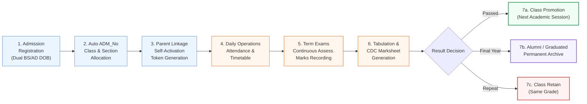
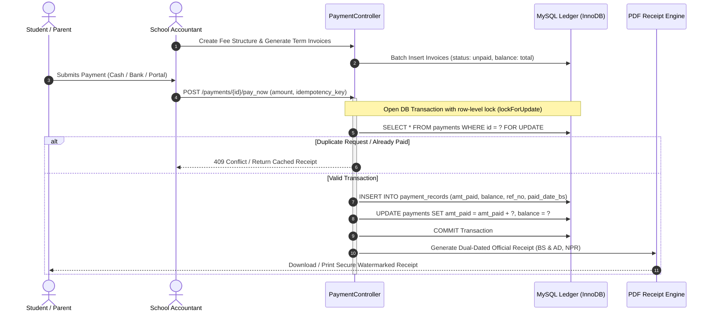
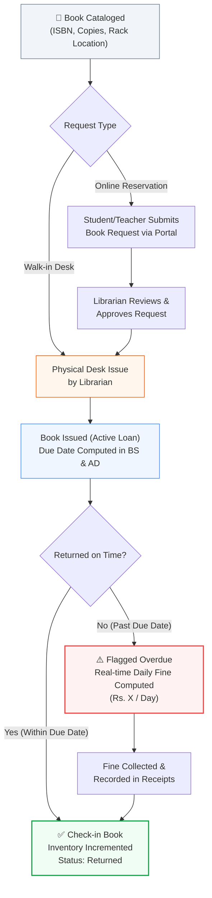
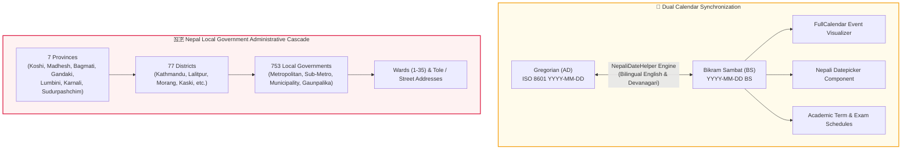
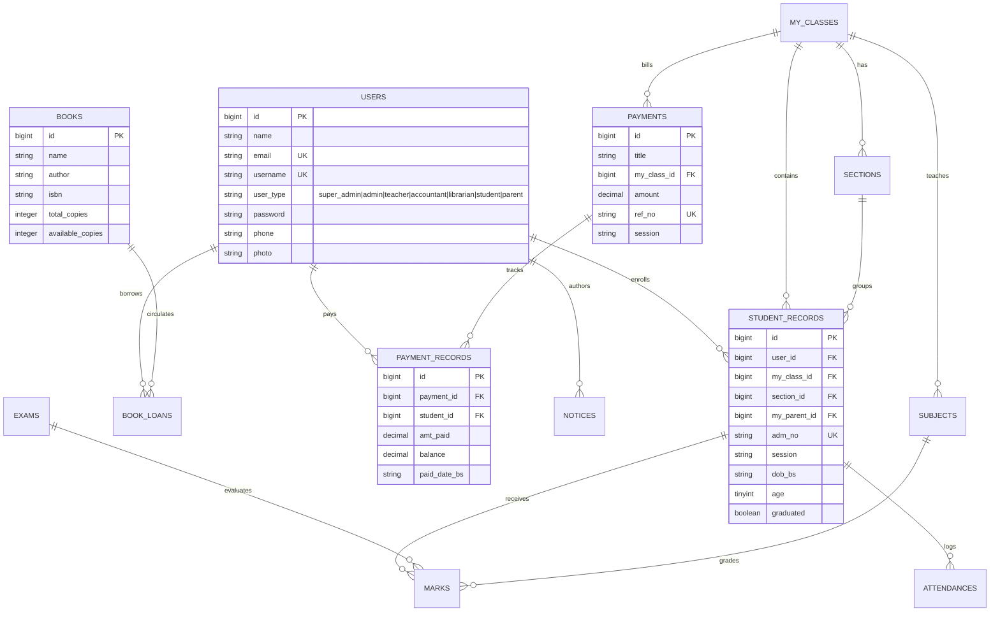

<div align="center">

# 🎓 SMS Academy — Enterprise School Management System
### *Smart School Management. Simplified.*

[](https://laravel.com)
[](https://php.net)
[](https://mysql.com)
[](https://web.dev/progressive-web-apps/)
[](https://en.wikipedia.org/wiki/Bikram_Sambat)
[](https://en.wikipedia.org/wiki/Role-based_access_control)
[](https://github.com/mohit282-cpu/SMS_Laravel/actions)
[](LICENSE)
[](SECURITY.md)

<br/>

**SMS Academy** is an enterprise-grade, multi-role School Management System engineered for educational institutions, primary/secondary schools, and collegiate academies. Featuring native **dual calendar synchronization (Nepali Bikram Sambat BS & Gregorian AD)**, full **Nepal administrative hierarchy mapping (7 Provinces, 77 Districts, 753 Local Governments)**, **Progressive Web App (PWA)** offline capabilities, **VAPID Web Push notifications**, and an **idempotent financial ledger**.

[📐 System Architecture](#-system-architecture) • [✨ Feature Showcase](#-comprehensive-feature-modules) • [🔄 Workflows & Lifecycles](#-core-workflows--lifecycle-diagrams) • [👥 Role Matrix](#-role-based-access-control-matrix) • [🚀 Quick Start](#-installation--quick-start) • [🛡️ Security](#-security-architecture--hardening) • [📖 Documentation](#-documentation-hub)

---

</div>

## 📌 Executive Feature Overview

```
┌─────────────────────────────────────────────────────────────────────────────────────────────┐
│                                   SMS ACADEMY ECOSYSTEM                                     │
├───────────────────────────────┬───────────────────────────────┬─────────────────────────────┤
│   👨‍🎓 ACADEMIC LIFECYCLE       │   💳 FINANCIAL OPERATIONS     │   🇳🇵 NEPAL LOCALIZATION     │
│   • Multi-term sessions       │   • Structured fee categories │   • Dual BS/AD Datepicker   │
│   • Automated student ADM     │   • Idempotent payment engine │   • Bikram Sambat calendar  │
│   • Class/Section rosters     │   • Row-level lock protection │   • 7 Provinces & 77 Dists  │
│   • Exam & Continuous Assess. │   • Multi-part partial pay    │   • 753 Palikas & Wards     │
│   • GPA / CDC letter grading  │   • Dual-dated PDF receipts   │   • NPR currency ledger     │
├───────────────────────────────┼───────────────────────────────┼─────────────────────────────┤
│   📚 LIBRARY & RESOURCES      │   📱 PWA & NOTIFICATIONS      │   🔐 ENTERPRISE SECURITY    │
│   • ISBN book cataloguing     │   • Add-to-homescreen PWA     │   • 7-role isolated RBAC    │
│   • Student/staff loan engine │   • Offline service workers   │   • Anti-SSRF WebPush guard │
│   • Automatic overdue fines   │   • VAPID Web Push alerts     │   • Private Cache-Control   │
│   • Class-isolated syllabus   │   • Mobile bottom touch dock  │   • Super Admin audit trail │
│   • Study material repository │   • 44px WCAG touch targets   │   • Fresh clean installer   │
└───────────────────────────────┴───────────────────────────────┴─────────────────────────────┘
```

---

## 📐 System Architecture

SMS Academy is architected around a modular MVC layout powered by Laravel 8, strict PHP 8.2 typing, and MySQL 8.0 InnoDB transactions.

```mermaid
flowchart TD
    subgraph CLIENTS["🌐 Multi-Device Client Layer"]
        A1["💻 Desktop Web Browsers\n(Chrome, Firefox, Safari, Edge)"]
        A2["📱 Mobile Devices & Tablets\n(PWA Touch Dock & Offline Cache)"]
    end

    subgraph SECURITY["🛡️ Security & Gateway Layer"]
        B1["🔒 HTTPS / TLS 1.3 Termination"]
        B2["🛡️ CSRF & Secure Cookie Protection"]
        B3["🚫 NoStorePrivateResponses Middleware\n(Cache-Control: no-store, private)"]
        B4["🔍 Anti-SSRF PushEndpointValidator\n(Blocks RFC1918 / Loopback / Metadata)"]
        B5["👥 Multi-Role Authorization Gates & RBAC"]
    end

    subgraph CORE["⚙️ Core Application Business Engines"]
        C1["🏫 Academic Lifecycle Engine\n(Admissions, Classes, Sections, Promotions)"]
        C2["📊 Exams & Assessment Engine\n(Continuous Assessment, GPA, Marksheets)"]
        C3["💳 Financial Billing & Ledger\n(Invoicing, Receipts, Row-level Locks)"]
        C4["🇳🇵 Nepal Localization Engine\n(Dual BS/AD Converter, Palika Hierarchy)"]
        C5["📚 Library & Circulation Engine\n(Book Loans, Reservations, Overdue Fines)"]
        C6["🕒 Timetable & Attendance Engine\n(Slot Generator, Daily Student/Staff Logs)"]
        C7["📢 Notice Board & PWA Push Engine\n(Role-targeted Alerts, VAPID Web Push)"]
    end

    subgraph STORAGE["💾 Data & Storage Layer"]
        D1[("🗄️ MySQL 8.0 / MariaDB\n(ACID InnoDB Transactions)")]
        D2["📁 Private & Public Storage\n(Protected Document Archives)"]
        D3["🔑 VAPID Cryptographic Keyring\n(Web Push Protocol RFC8292)"]
    end

    CLIENTS --> SECURITY
    SECURITY --> CORE
    CORE --> STORAGE

    style CLIENTS fill:#F8FAFC,stroke:#CBD5E1,stroke-width:2px;
    style SECURITY fill:#EFF6FF,stroke:#3B82F6,stroke-width:2px;
    style CORE fill:#FFF7ED,stroke:#FF5700,stroke-width:2px;
    style STORAGE fill:#F0FDF4,stroke:#16A34A,stroke-width:2px;
```



---

## 👥 Role-Based Access Control Matrix

The system enforces strict multi-tenant boundary separation across **7 user roles**:

| Feature Module | Super Admin | Admin | Accountant | Librarian | Teacher | Student | Parent |
|---|:---:|:---:|:---:|:---:|:---:|:---:|:---:|
| **System Settings & Clean Installer** | ✅ Full | ❌ | ❌ | ❌ | ❌ | ❌ | ❌ |
| **Audit Logs & Security Trail** | ✅ Full | ❌ | ❌ | ❌ | ❌ | ❌ | ❌ |
| **User Provisioning & Staff Records** | ✅ Full | ✅ Full | ❌ | ❌ | ❌ | ❌ | ❌ |
| **Student Admissions & Profiles** | ✅ Full | ✅ Full | 👁️ Read | 👁️ Read | 👁️ Assigned | 👁️ Self | 👁️ Linked Children |
| **Class, Section & Subject Setup** | ✅ Full | ✅ Full | ❌ | ❌ | 👁️ Read | ❌ | ❌ |
| **Class & Exam Timetables** | ✅ Full | ✅ Full | 👁️ Read | 👁️ Read | 👁️ Assigned | 👁️ Enrolled | 👁️ Linked Children |
| **Student Daily Attendance** | ✅ Full | ✅ Full | ❌ | ❌ | ✅ Mark/Edit | 👁️ Self | 👁️ Linked Children |
| **Staff & Teacher Attendance** | ✅ Full | ✅ Full | ❌ | ❌ | 👁️ Self | ❌ | ❌ |
| **Exam Setup & Term Scheduling** | ✅ Full | ✅ Full | ❌ | ❌ | 👁️ Read | 👁️ Read | 👁️ Read |
| **Marks Entry & Assessment Grading** | ✅ Full | ✅ Full | ❌ | ❌ | ✅ Assigned Subjects | ❌ | ❌ |
| **Official Marksheet & Tabulation** | ✅ Full | ✅ Full | ❌ | ❌ | 👁️ Read | 👁️ Self (with PIN) | 👁️ Linked (with PIN) |
| **Fee Structures & Invoices** | ✅ Full | 👁️ Read | ✅ Full | ❌ | ❌ | 👁️ Self Invoices | 👁️ Linked Children |
| **Payment Recording & Receipts** | ✅ Full | ❌ | ✅ Full | ❌ | ❌ | 👁️ Download | 👁️ Download |
| **Library Catalog & Book Inventory**| ✅ Full | 👁️ Read | ❌ | ✅ Full | 👁️ Read | 👁️ Read | ❌ |
| **Book Loan Issuance & Fine Collection**| ✅ Full | ❌ | ❌ | ✅ Full | ❌ | ❌ | ❌ |
| **Book Reservations & Requests** | ✅ Full | ❌ | ❌ | ✅ Manage | ✅ Request | ✅ Request | ❌ |
| **Study Materials & Lecture Notes** | ✅ Full | ✅ Full | ❌ | ❌ | ✅ Upload/Edit | 👁️ Download | 👁️ Download |
| **Dormitory & Hostel Allocation** | ✅ Full | ✅ Full | ❌ | ❌ | ❌ | 👁️ Assigned Bed | 👁️ Linked Children |
| **School Calendar & Holidays (BS/AD)**| ✅ Full | ✅ Full | 👁️ Read | 👁️ Read | 👁️ Read | 👁️ Read | 👁️ Read |
| **Notices & Push Announcements** | ✅ Publish | ✅ Publish | 👁️ Read | 👁️ Read | 👁️ Read | 👁️ Read | 👁️ Read |

*Legend: ✅ Full Access & Mutations • 👁️ Read-Only Scope • ❌ Access Prohibited*

---

## 🔄 Core Workflows & Lifecycle Diagrams

### 1. Student Academic Lifecycle

From first admission inquiry to class promotion or graduation archive:



---

### 2. Financial Ledger & Idempotent Payment Flow

Prevents duplicate billing, race conditions, and parameter tampering:



---

### 3. Library Circulation & Fine Lifecycle

Full physical lending lifecycle with automated overdue fine calculation:



---

### 4. Nepal Dual-Calendar & Administrative Cascading Engine



---

## ✨ Comprehensive Feature Modules

### 🏫 1. School Identity & Institutional Settings
- **Branding & Profile**: Configure official school name, acronym, logo, crest, website, and motto.
- **Official Credentials**: Multi-line address, contact telephone, official email, and PAN/VAT registration numbers.
- **Academic Session Locks**: Define current active session (e.g. `2083/84 BS`) and switch historical terms without altering ledger archives.
- **Clean First-Run Handover**: Built-in interactive installer (`php artisan sms:install`) ensures zero leftover test data on fresh school deployment.

### 🇳🇵 2. Nepal Localization & Administrative System
- **Constitutional Governance Mapping**: Pre-seeded database covering all 7 Provinces, 77 Districts, and 753 Local Levels (Metropolitan, Sub-Metropolitan, Municipalities, and Rural Municipalities/Gaunpalikas).
- **Ward & Tole Granularity**: Captures student, parent, and staff residential addresses down to Ward number and localized Tole/Street names.
- **Bilingual Nomenclature**: Supports simultaneous English and Devanagari script representation for official certificates and documents.
- **National Currency**: Standardized Nepalese Rupee (`NPR` / `Rs.`) financial calculations.

### 📅 3. Bikram Sambat (BS) Dual Calendar Engine
- **Algorithmic BS ↔ AD Conversion**: High-performance, tested algorithmic translation covering historical and future calendar dates.
- **Interactive Nepali Datepicker**: Intuitive calendar picker for admission dates, birthdays, fee due dates, and exam periods.
- **Dual-Dated School Calendar**: FullCalendar interactive agenda showing public holidays, Dashain/Tihar school closures, examination windows, and sports meets with dual BS/AD tags.

### 👨‍🎓 4. Student Information & Lifecycle Management
- **Automated Admission Register**: Configurable admission numbering (`ADM_No`) format, session tagging, and photo uploads.
- **Demographic & Health Attributes**: Date of birth (BS & AD), blood group, nationality, gender, and emergency guardian details.
- **Parent Portal Linkage**: Links multiple siblings to one unified parent account.
- **Bulk Promotion Engine**: End-of-year promotion workflow to roll forward students class-by-class, mark repeaters, or transition final-year students into the Graduated Alumni Archive.

### 👩‍🏫 5. Faculty & Staff Human Resources
- **Staff Records**: Comprehensive employee profiles across teaching, administrative, accounting, and library staff.
- **Teacher Subject Mapping**: Assign subject specialists to specific classes and sections.
- **Staff Daily Attendance**: Daily check-in/check-out logs, punctuality metrics, and monthly leave summaries.

### 📚 6. Academic Classes, Sections & Subjects
- **Class Tier System**: Nursery, Primary, Junior, and Senior secondary classifications.
- **Flexible Section Divisions**: A, B, C section capacity management.
- **Subject Specialization**: Core mandatory and elective subjects mapped with individual credit weights and pass thresholds.
- **Study Materials Repository**: Secure teacher upload repository for syllabi, homework assignments, and lecture notes with strict class/section access isolation.

### 🕒 7. Timetable Builder & Dynamic Slot Scheduling
- **Automated Time-Slot Division**: Define standard class period durations, short breaks, and lunch intervals.
- **Conflict-Free Scheduling**: Visual weekly timetable grid ensuring no teacher or room is double-booked across sections.
- **Examination Timetable Generator**: Distinct exam timetable builder displaying paper dates, timing, and hall allocations.

### 📝 8. Student Attendance & Tracking
- **Rapid Classroom Roll Call**: Clean one-click attendance interface optimized for tablet and mobile screens.
- **Status Classification**: Present, Absent, Late, or Excused with contextual remarks.
- **Monthly Attendance Tabulation**: Printable attendance registers and aggregate percentages displayed on student report cards.

### 📊 9. Examination, Grading & Report Cards
- **Continuous Assessment (CA)**: Configurable multi-tier evaluation (1st CA, Mid-Term CA, 2nd CA, Final Examination).
- **Grading Systems**: Standard 4.0 GPA scale, Nepal Curriculum Development Centre (CDC) letter grading (A+, A, B+, B, C+, C, D, E), and custom percentage brackets.
- **Batch Mark Entry**: High-speed spreadsheet-like mark entry interface for teachers.
- **Official Print-Ready Marksheets**: Beautifully styled, watermarked report cards with principal signature lines, grading keys, and dual BS/AD dates.
- **Broadsheet Tabulation**: Comprehensive class-wide broadsheet showing all students across all subjects for faculty moderation.

### 💳 10. Fee Management, Billing & Financial Ledger
- **Fee Structures**: Set up annual, term, tuition, bus, lab, and examination fee categories per class.
- **Invoice Generation**: Automated batch invoice creation per term or student cohort.
- **Idempotent Payment Engine**: Robust transaction handling with MySQL `lockForUpdate` guarantees zero double-billing or race hazards.
- **Partial Payment Tracking**: Transparent running balances, discount waivers, and paid-to-date ledgers.
- **Dual-Dated PDF Receipts**: Instant thermal or A4 printable receipts with school letterhead, student details, and receipt reference numbers.

### 📖 11. Library Catalog & Circulation Desk
- **Book Registry**: ISBN, title, author, publisher, genre/category, edition, shelf location, and copy count.
- **Circulation Lifecycle**: Instant issue, renewal, and check-in workflows for students and teachers.
- **Online Book Reservations**: Students can search the catalog and request books from their student dashboard.
- **Automated Overdue Fines**: Calculates overdue days against loan limits and computes overdue fines upon book return.

### 🏢 12. Hostel & Dormitory Management
- **Hostel Facilities**: Manage boy's and girl's dormitories, wardens, and building wings.
- **Room & Bed Allocations**: Track room capacities, occupied beds, and assign boarding students.

### 📢 13. Notice Board, Announcements & Events
- **Targeted Announcements**: Publish school notices targeted to All, Teachers Only, Parents Only, or Students Only.
- **Event Calendar**: Public and internal holiday calendar with school closure indicators.

### 🔐 14. Security, Scratch-Card PINs & Audit Trail
- **Marksheet Scratch PINs**: Secure PIN generation and verification system preventing unauthorized marksheet access.
- **Comprehensive Audit Log**: Tracks critical administrative actions, IP addresses, timestamps, and mutated models.
- **Secure Authentication**: Bcrypt password hashing, session expiration, and HTTPS-only cookie protection.

### 📱 15. Progressive Web App (PWA) & Web Push
- **Installable PWA**: Fast standalone app experience on Android, iOS, Windows, and macOS without app store downloads.
- **VAPID Web Push Protocol**: Real-time push notifications delivered to devices even when the browser is closed.
- **Mobile Touch Dock**: Ergonomic bottom navigation dock with 44px WCAG-compliant touch targets for smartphones.
- **Offline Resilient**: Service worker caches core layouts and styles for smooth offline fallback.

---

## 💾 Database Schema & Key Entities



---

## 🗂️ Project Structure & Directory Layout

```
SMS_Laravel/
├── app/
│   ├── Console/Commands/        # Artisan CLI commands (sms:install, db:backup, etc.)
│   ├── Helpers/                 # Core utility helpers (Qs, Pay, NepaliHelper, Mark)
│   ├── Http/
│   │   ├── Controllers/         # Role-segregated resource controllers
│   │   ├── Middleware/          # Security, auth, cache-control, and role gates
│   │   └── Requests/            # Form validation request classes
│   ├── Models/                  # Eloquent entities & relationships
│   └── Repositories/            # Data access repository layer
├── config/                      # Application, database, PWA, and push config
├── database/
│   ├── migrations/              # Database schema migrations
│   └── seeders/                 # Baseline master reference seeders
├── docs/                        # Complete technical documentation hub
│   ├── audit/                   # Security, performance, and code audit reports
│   ├── deployment/              # Fresh installation assessments & guides
│   └── handover/                # Official school operational handover guides
├── public/
│   ├── assets/
│   │   ├── css/                 # sms-design-system.css & localized stylesheets
│   │   ├── js/                  # Interactive clients, datepicker, and PWA logic
│   │   └── images/              # Logos, watermarks, and PWA icons
│   ├── manifest.json            # PWA Web Application Manifest
│   └── sw.js                    # Service Worker (Offline caching & Push listener)
├── resources/
│   ├── lang/                    # English & Nepali (Devanagari) localization files
│   └── views/                   # Blade templates categorized by role and workflow
├── routes/                      # Web and API routing declarations
└── tests/                       # Automated PHPUnit Feature, Unit & Security test suites
```

---

## 🚀 Installation & Quick Start

### 📋 Prerequisites
- **PHP**: `8.2` (Required extensions: `pdo_mysql`, `mbstring`, `openssl`, `tokenizer`, `xml`, `ctype`, `json`, `bcmath` or `gmp`)
- **Web Server**: Apache 2.4+ / Nginx 1.20+ with URL rewriting enabled
- **Database**: MySQL `8.0+` or MariaDB `10.4+` (InnoDB engine)
- **Composer**: `2.x`

---

### 💻 Step-by-Step Setup

#### 1. Clone the Repository
```bash
git clone https://github.com/mohit282-cpu/SMS_Laravel.git
cd SMS_Laravel
```

#### 2. Install PHP Dependencies
```bash
composer install --no-dev --optimize-autoloader
```

#### 3. Configure Environment File
```bash
cp .env.example .env
php artisan key:generate
```

Configure your MySQL database parameters in `.env`:
```ini
APP_NAME="SMS Academy"
APP_ENV=production
APP_DEBUG=false
APP_URL=https://school.yourdomain.edu.np

DB_CONNECTION=mysql
DB_HOST=127.0.0.1
DB_PORT=3306
DB_DATABASE=sms_laravel_prod
DB_USERNAME=sms_user
DB_PASSWORD=your_secure_password
```

#### 4. Run Migrations & Master Reference Data
```bash
php artisan migrate --force
php artisan db:seed --class=ProductionReferenceSeeder --force
```

#### 5. Generate Web Push VAPID Cryptographic Keys
```bash
php artisan webpush:vapid
```

#### 6. Link Storage & Optimize Caches
```bash
php artisan storage:link
php artisan config:cache
php artisan route:cache
php artisan view:cache
```

#### 7. Launch Local Development Server
```bash
php artisan serve
```
Visit `http://127.0.0.1:8000` in your web browser.

---

## 🏫 Fresh Production Handover (`sms:install`)

To deploy SMS Academy for a brand new school with **zero demo records**, a clean database, and an initialized Super Admin, run the automated installation command:

```bash
php artisan sms:install
```

### Command Capabilities:
1. **Verifies Environment**: Validates database connectivity, MySQL InnoDB prerequisites, and disk write permissions.
2. **Schema & Reference Initialization**: Applies all migrations and seeds only required reference data (Nepal Provinces, Districts, Palikas, Nationalities, Blood Groups).
3. **No Demo Data**: Zero dummy students, teachers, marks, or payments are created.
4. **Interactive Super Admin Provisioning**: Securely prompts for official administrator credentials with hidden password entry and immediate password hashing.
5. **School Identity Configuration**: Configures official school name, address, phone, email, and starting academic session.

```bash
# Non-interactive automated deployment (e.g., Docker / CI / Cloud-Init):
php artisan sms:install --force \
  --admin-name="Principal Administrator" \
  --admin-username="superadmin" \
  --admin-email="admin@school.edu.np" \
  --admin-phone="9800000000" \
  --admin-password="YourStrongSecurePassword123!" \
  --school-name="Apex Model Secondary School" \
  --school-short="AMSS" \
  --school-address="Birendranagar-4, Surkhet, Karnali Province" \
  --school-phone="083-520000" \
  --school-email="info@apexschool.edu.np" \
  --session="2083/84 BS"
```

---

## 🛡️ Security Architecture & Hardening

1. **Anti-SSRF Push Validation (`PushEndpointValidator`)**:
   All incoming Web Push subscription URLs are resolved and verified against DNS rebinding, private IP ranges (RFC 1918), loopback interfaces (`127.0.0.1`), link-local IPs (`169.254.0.0/16`), and cloud instance metadata services before saving.
2. **Strict Private Response Caching (`NoStorePrivateResponses`)**:
   All authenticated routes and downloaded artifacts (PDF receipts, exam marks, student records) emit `Cache-Control: private, no-store, no-cache, must-revalidate` headers to prevent sensitive data caching on shared proxy servers.
3. **Row-Level Transaction Locking**:
   Fee payments employ MySQL InnoDB row-level locking (`lockForUpdate`) combined with client idempotency tokens, completely eliminating race conditions and accidental double billing.
4. **Data Isolation by Role**:
   Teachers only have access to their assigned classes, sections, and subjects. Parents can only inspect their own verified children's records.
5. **Audited Security Trail**:
   Administrative user provisioning, password resets, and critical system mutations are logged with timestamps, operator IDs, and client IP addresses.

---

## 🧪 Testing & Quality Assurance

The application maintains a comprehensive automated testing suite utilizing an isolated disposable test database (`sms_laravel_test`):

```bash
# Prepare isolated test database
mysql -u root -e "CREATE DATABASE IF NOT EXISTS sms_laravel_test CHARACTER SET utf8mb4 COLLATE utf8mb4_unicode_ci;"

# Execute complete test suite
php artisan test

# Run targeted test suites
vendor/bin/phpunit tests/Feature/FreshInstallationCommandTest.php
vendor/bin/phpunit tests/Feature/UiShellAndNavigationTest.php
vendor/bin/phpunit tests/Feature/FirstSchoolOnboardingWorkflowTest.php
vendor/bin/phpunit tests/Unit/ReleaseArchiveSecurityTest.php
```

---

## 📖 Documentation Hub

For in-depth operational and architectural documentation, refer to the [`docs/`](docs/) directory:

- 📋 [**School Handover Checklist**](docs/handover/SCHOOL_HANDOVER_CHECKLIST.md) — Pre-handover sign-off and administrative procedures.
- 🛠️ [**School Configuration Guide**](docs/handover/SCHOOL_CONFIGURATION_GUIDE.md) — Step-by-step first-run setup of academic terms, classes, and fees.
- 💾 [**Backup & Disaster Recovery Guide**](docs/handover/BACKUP_AND_RESTORE_GUIDE.md) — MySQL snapshotting, automated backups, and restoration verification.
- 👮 [**Super Administrator Operations Guide**](docs/handover/SUPER_ADMIN_GUIDE.md) — Role delegations, audit log reviews, and system maintenance.
- 📱 [**Responsive UI & Touch Target Report**](docs/RESPONSIVE_FIX_REPORT.md) — Mobile viewport audit, WCAG touch target compliance, and scroll guards.
- 🇳🇵 [**Nepal Administrative & Location System**](docs/NEPAL_LOCATION_SYSTEM.md) — Technical details of the 7-province / 753-palika cascade.
- 🔒 [**System Security Architecture**](docs/handover/SECURITY_AND_PRIVACY_GUIDE.md) — Threat models, session protection, and data privacy safeguards.
- 🛡️ [**Vulnerability Disclosure Policy**](SECURITY.md) — Reporting guidelines, SLA response targets, and Coordinated Disclosure.

---

## 🛡️ Security Policy & Vulnerability Disclosure

For vulnerability reporting, SLA response times, and Coordinated Disclosure policies, review our official [**SECURITY.md**](SECURITY.md). Security issues must be submitted directly to `security@smsacademy.edu.np`.

---

## 📄 License & Attribution

This software is licensed under the [MIT License](LICENSE).  
Copyright &copy; 2021 **Chinedu Okemiri** &bull; Copyright &copy; 2026 **SMS Academy / Sovryx Tech Pvt. Ltd.** &bull; Engineered for Excellence in Education.
